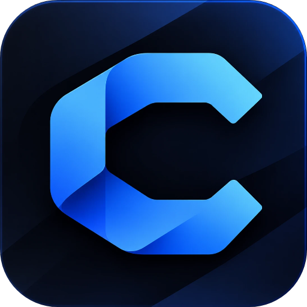

# Coder



A fast, lightweight code editor built with [Avalonia](https://avaloniaui.net/) in **pure C#** — no XAML anywhere.

## Install

**Windows**: download `Coder-win-Setup.exe` from the [latest release](https://github.com/HamzaBaghdadi/coder/releases/latest) and run it. It installs for your user only (no administrator rights) and adds Coder to the Start menu. macOS and Linux builds come later.

The installer isn't code-signed yet, so Windows SmartScreen may say it "protected your PC": choose **More info → Run anyway**.

### Updates

Coder keeps itself current. About 20 seconds after it starts, and every 4 hours after that, it checks GitHub Releases. A new version downloads in the background, only the changed files when it can. Then a **Restart to Update** button appears in the status bar, and the cog in the title bar gets a dot. Restart whenever you like: unsaved files are handled as on a normal close. Or just keep working: the update installs when you close Coder, so the next start is up to date. **Check for Updates…** is in the cog menu and the command palette.

### Releasing

Raise `<Version>` in `Directory.Build.props`, then push a matching tag:

```powershell
git tag v0.2.0
git push origin v0.2.0
```

The Release workflow runs the Core tests and `tools/release.ps1 -Publish`. That script publishes a self-contained win-x64 build and packs it with [Velopack](https://velopack.io) (installer, full package, and a delta from the previous release), then creates the GitHub release that installed copies update from. To build the installer locally, run `tools/release.ps1` (`dotnet tool restore` fetches `vpk` first).

## Run from source

```powershell
dotnet run --project src/Coder.App -- <folder-or-file>
dotnet run --project src/Coder.App -- --user-data-dir <folder> <folder-or-file>   # separate settings and logs
dotnet test
```

`dotnet test` runs unit tests and headless UI tests: the real workbench, rendered off-screen, with real shells, git and language servers where installed. `tools/smoke/Run.ps1` also drives a real Coder window on Windows through UI Automation, clicking buttons and pressing keys the way a user does. It covers terminals (adding, splitting and killing them), dragging the editor's scroll bar with the real mouse (the thumb must stay under the pointer), the search view, opening files and diffs with the keyboard, committing through Source Control (and seeing it in the graph), publishing and switching branches against a temporary local remote, resolving a real merge conflict and committing the merge, rename, Find All References and workspace symbol search with gopls, HTML completion and Prettier with the servers Coder ships, typing and deleting after `</html>`, and switching to the light theme (and starting in it next time). It uses its own `--user-data-dir`, so your settings are untouched. Don't type while it runs (about a minute), because the window comes to the front for shortcut keys. If Windows won't bring it forward, those checks fail rather than send keys to another window. The branch checks need no focus at all: they set text through UI Automation and post Enter to Coder's window only.

## Themes

Pick a theme with `Preferences: Color Theme` (`Ctrl+K Ctrl+T`). Moving through the list shows each theme at once; Enter keeps it and Esc goes back. The choice is remembered. Midnight Blue and Daylight are derived from the logo; Follow System switches with Windows' light, dark or contrast mode.

- **Midnight Blue** has near-black navy surfaces (`#06080D`–`#121826`; never pure `#000`, which causes glare and text smearing on many screens), soft off-white text (`#D5DBE5`), and the logo's blue → cyan sweep for accents. Its syntax colors are cool and muted, so long sessions stay easy on the eyes.
- **Daylight** is its light counterpart: cool near-white surfaces (`#E9EDF3`–`#FFFFFF`), deep navy text (`#1A2332`), and the same brand blue, darkened for contrast. Its syntax and terminal colors are deeper versions of the dark ones.
- **High Contrast Dark** and **High Contrast Light** are for low vision and glare, like VS Code's: pure black (or white) surfaces, every region outlined (cyan, or deep blue), focus and find matches in orange, and text at 7:1 or more. With Follow System, Windows' contrast themes choose them.
- **VS Code themes** are listed too, with nothing to install: the themes built into VS Code (Dark Modern, Monokai, Solarized…) and those of your installed VS Code extensions, found in VS Code's folders. You can also drop a theme `.json` into the `themes` folder next to `settings.json`. Coder reads the theme's workbench colors and its syntax rules (TextMate scopes, with `include` and comments), and whatever the theme leaves out comes from the built-in theme of the same kind.

Components use named tokens (`App/Theme/Palette.cs`), never raw colors. Each theme is a table of token values (`App/Theme/ColorThemes.cs`), so adding a theme is data only. Tests check that every theme defines every token, and that text and syntax colors keep at least 4.5:1 contrast (WCAG AA) on the editor and side bar.

## Logo and icons

The original artwork is `assets/source/coder-logo-original.webp`. After changing it, regenerate the transparent `assets/coder.png` (in-app logo) and the multi-size `assets/coder.ico` (executable icon):

```powershell
dotnet run --project tools/Coder.IconTool -- assets/source/coder-logo-original.webp assets
```

File and folder icons are the [Material Icon Theme](https://github.com/material-extensions/vscode-material-icon-theme) (MIT; its license is in `assets/material-icons/LICENSE`), shipped with Coder and matched like VS Code matches them: exact file name, then the longest extension (`app.component.ts`, `.d.ts`), then the language, with light-theme variants. `tools/Coder.MaterialIcons` converts the npm package into compact vector layers, which take 1 MB for all 1,256 icons and need no SVG library. Each icon is built the first time it is shown. To update them:

```powershell
npm pack material-icon-theme   # then unpack the .tgz
dotnet run --project tools/Coder.MaterialIcons -- <unpacked>/package assets/material-icons
```

The tool finds the rounded tile, measures its corner radius, and makes everything outside it transparent.

## Error logs

If something unexpected goes wrong, Coder keeps running, shows a short message in the status bar, and writes the full error to `%LOCALAPPDATA%\Coder\logs\coder-<date>.log`. Please include that file when reporting a bug.

## Architecture

Dependencies point inwards only. Each layer is its own project, so the rules are enforced by the compiler.

```
Coder.App  ──►  Coder.Presentation  ──►  Coder.Core
(Avalonia)      (view models, commands)   (text, editing, syntax, files)
```

| Project | Responsibility | Knows about UI? |
|---|---|---|
| `Coder.Core` | Piece-table text storage, undo history, editing model (`EditorState`), incremental syntax highlighting, file IO, fuzzy search, terminal emulation (VT parser and cell grid), Language Server Protocol client (JSON-RPC, server catalog, snippets) | No |
| `Coder.Presentation` | View models for the workbench, explorer, tabs, status bar, command palette, completion; language services (one server per project root, document sync, diagnostics); the command registry; service contracts (`IDialogService`) | No |
| `Coder.App` | Views written in C#, the custom editor control, theme tokens and styles, platform services, composition root | Yes |
| `tools/Coder.IconTool` | Turns the logo artwork into `assets/coder.png` and `assets/coder.ico` | — |

### Performance and memory choices

- **Piece table** (`Core/Text/PieceTable.cs`): a file is held once as loaded; edits only append. Line lookups use a lazily rebuilt prefix index (O(log pieces)). Consecutive typing extends one piece instead of creating new ones.
- **Virtualized rendering** (`App/Editor/EditorView*.cs`): only visible lines are shaped and drawn; shaped lines are cached near the viewport and evicted from the edited line on change. Very long lines are shaped only for the visible columns.
- **Incremental highlighting** (`Core/Syntax/SyntaxHighlighter.cs`): the lexer state at the end of each line is remembered; an edit invalidates from that line and nothing is lexed until it is shown.
- **One editor control for all tabs**: switching tabs swaps the model and restores the scroll position.
- **Tabs scroll** when there are more than fit: a slim scroll bar appears under them, the mouse wheel moves them sideways, and the active tab is always scrolled into view.
- **Files changed on disk reload**: when git (a discard, checkout or pull), a formatter or another program changes an open file, its tab shows the new content as one undo step. A tab with unsaved changes keeps them.
- **Flat explorer list**: folders load lazily on expand and the list virtualizes. The header has New File, New Folder, Refresh and Collapse All; new names are typed in place (`src/app.ts` creates the folders too). Right-click a file or folder for New File/Folder, Reveal in File Explorer, Open in Integrated Terminal, Copy Path, Copy Relative Path, Rename (`F2`) and Delete (`Delete`, to the Recycle Bin after confirming). Drag files and folders onto a folder to move them; open tabs follow renames and moves. The file you are editing is revealed and selected (from tabs, `Ctrl+P`, go to definition…), which `Explorer: Auto Reveal` turns off.
- **Minimap**: the code in miniature on the editor's right edge, with a slider for the visible part. Click to jump, drag to scroll. By default each line is one quiet bar (nothing is lexed for it); Settings → `Minimap: Render Characters` draws the words in their token colors instead. Shapes are built once for a band of about three screens and only moved while scrolling. `View: Toggle Minimap`.
- **Ctrl+hover** on a symbol underlines it with a hand pointer when the language server can go to its definition; Ctrl+Click goes there.
- **International text**: lines are laid out with real glyph positions (not a fixed character grid), so carets, selections and clicks stay correct for Arabic (shaped, right-to-left), Chinese/Japanese/Korean (wide) and emoji. The editor picks a font per character from an explicit fallback list (`Typography.CodeFallbackFamilies`) instead of relying on automatic fallback, which in Avalonia 12 can draw Arabic as empty boxes. Input methods (IME) get the caret position for their candidate window, and text being composed is shown at the caret.
- **Replace in files** re-searches each file at replace time, keeps its encoding (BOM included) and line endings, and changes files that are open in an editor through the editor (undoable, left unsaved) instead of on disk.
- **Integrated terminal**: the shell runs in a Windows pseudo console (ConPTY); `Core/Terminal` parses its output (an xterm subset: 16/256/true colors, cursor movement, scroll regions, alternate screen, bracketed paste) into a cell grid with 5,000 lines of scrollback. Output is batched to one redraw per UI frame, and only visible rows are shaped, each cached until that row changes. While the terminal has focus, keys go to the shell except the terminal toggles, `Ctrl+P` and `Ctrl+Shift+P`. Each terminal is its own shell, listed on the right of the panel like VS Code's terminal tabs (hover a row to kill it); the panel's top bar switches between Problems and Terminal. Killing the last terminal hides the panel. **Split Terminal** (`Ctrl+Shift+5`, or the split button) starts a shell beside the active one: they show side by side with a splitter between them, and the list joins them with tree lines. Each terminal has a scroll bar for its history (5,000 lines), which follows new output and the wheel; drag it or click its track to scroll back. **Shells**: PowerShell (7 when installed), Windows PowerShell, Command Prompt, Git Bash and WSL are found on their own; the arrow next to `+` starts a terminal with any of them, and `Terminal: Select Default Profile` picks the one new terminals start (remembered). **Find** with `Ctrl+F` while the terminal has focus: matches in the history and on screen are highlighted, the newest first; `Enter` goes up to older ones, `Shift+Enter` back down, and "Aa" matches case. **Links**: web addresses and file paths in the output (as compilers, test runners and stack traces print them: `src\app.cs(12,5)`, `main.go:7:2`, `/home/me/index.js:3:9`) are underlined under the pointer, and `Ctrl+Click` opens them: files in the editor at that line and column, addresses in your browser. Paths count only when the file exists; relative ones are found from the shell's current folder. **Shell integration** (PowerShell): each command's prompt gets a dot in the left margin, an accent ring when it succeeded and a red dot when it failed (hover for the exit code), and `Ctrl+Up` / `Ctrl+Down` scroll to the previous or next command. Coder knows the shell's current folder, so links follow `cd` and a split starts where you are. It works by wrapping your prompt (your profile and prompt theme stay as they are).
- **Source Control** runs the `git` command line, like VS Code, so your git configuration applies and nothing native is loaded. Status is read with `--porcelain=v2 -z` (exact paths, renames, conflicts) and refreshed shortly after files change on disk, on save, and after every operation.
- **Images** (PNG, JPEG, GIF, BMP, WebP, ICO) open in an image tab: fitted to the view, on a checkerboard for transparency, with their size. `Ctrl+wheel` zooms and a double-click fits again. Only the shown image is decoded.
- **Scrolling** moves 3 lines per wheel tick, like VS Code. The scroll bars are thin and arrowless: a rounded thumb that brightens on hover and while dragged, in theme colors.
- **Layout**: the title bar shows the project; clicking it (or Ctrl+R) opens a dropdown of recent projects, and toggles for the side bar, the bottom panel and the secondary side bar, which is reserved for agents and other views. The primary side bar can be on the left or the right (`View: Toggle Primary Side Bar Position`; the secondary side bar takes the other side), and the activity bar on the window's edge, across the top or bottom of the side bar, or hidden (`View: Activity Bar Position…`). Double-click a divider to put it back: the side bar returns to its default width from settings.
- **Window**: minimize, maximize and restore animate like any Windows app: the window keeps its native frame (so Windows animates and snaps it), and Coder draws its own title bar and caption buttons over the caption area. When minimized, Coder compacts its memory and gives the freed pages back to Windows.
- **Search in files** runs on a background thread, streams results per file, cancels on every new keystroke, and skips binary, huge (>4 MB) and build/VCS folders.

Measured (Release, Windows, a folder and a 1,000-line file open, after scrolling it). Coder's own share is small; most of the GPU figure is the graphics driver (ANGLE over Direct3D 11, which was the leanest: OpenGL used about 255 MB and Vulkan about 315 MB, and capping Skia's GPU cache saved almost nothing). `Developer: Show Memory Usage` shows the numbers for your session.

| Renderer | Private memory | Threads | Processor work while scrolling |
|---|---|---|---|
| GPU (default) | ~185 MB (empty window ~135 MB) | ~70 | 1× |
| Software (Settings → GPU Acceleration off, then restart) | ~70 MB (empty window ~50 MB) | ~17 | ~2× |

## Language servers

Coder speaks the Language Server Protocol. When you open a file, Coder starts that language's server if it is installed: one server per project root, found by markers such as `go.mod`, `Cargo.toml` or `package.json`. It then gives you:

**Comes with Coder: HTML, CSS (and SCSS, Less), JSON, TypeScript and JavaScript (with JSX), Tailwind CSS IntelliSense and Prettier.** Nothing to set up: the first time you open such a file, Coder installs its server with npm into its own data folder (`servers` next to `settings.json`) and starts it; the status bar says what it is doing. Release builds can ship them pre-installed with their own Node.js (`tools/bundle-servers.ps1 -AppFolder <app>` adds a `servers` folder next to the app, about 195 MB), so they work offline and without Node.js. Without a bundle, Node.js 20 or newer is needed.

- **Tailwind CSS IntelliSense** runs beside the HTML, CSS and TypeScript servers in projects that use Tailwind (a `tailwind.config.*` file, or `tailwindcss` in package.json): class names (with their colors) in the same completion list, the CSS a class stands for on hover, and warnings for conflicting classes. Projects without Tailwind never start it.
- **Prettier** formats HTML, CSS, SCSS, Less, JavaScript, TypeScript, JSX, JSON, Markdown, YAML and more with `Shift+Alt+F`, following the project's own settings (`.prettierrc`, `"prettier"` in package.json, `.editorconfig`).

- **Diagnostics**: wavy underlines (red errors, amber warnings, blue info, dotted hints) that follow your edits until the server sends new ones, with error and warning counts in the status bar.
- **Completion** as you type a word or a trigger character such as `.`, or with `Ctrl+Space`. The typed letters are highlighted in each suggestion. Snippets place the caret on their first placeholder, and added imports are applied too.
- **Hover**: rest the pointer on a symbol to see its signature (syntax colored), its documentation and any problems there.
- **Go to definition** with `F12` or `Ctrl+Click`.
- **Find all references** with `Shift+F12`: every use, grouped by file in the REFERENCES tab of the bottom panel, each with its line and the symbol highlighted. Click one to go there; `F4` and `Shift+F4` step through them from anywhere.
- **Go to symbol** in the file with `Ctrl+Shift+O` (or `@` in the palette): its classes, functions and fields in file order, each with what it is and where it sits. **In the workspace** with `Ctrl+T` (or `#`): symbols by name from every running server, with their files.
- **Inlay hints**: parameter names and inferred types, shown faintly inside the code (`add(left: 2, right: 3)`, `total int := …`). They take space on screen but not in the file, so the caret, selection and clicks skip over them. `View: Toggle Inlay Hints` turns them off (remembered). gopls's hints are turned on for you.
- **Rename symbol** with `F2`: type the new name in the box (it starts with the current one) and press Enter. Files open in an editor change there as one undo step, left unsaved for review. When the server also creates, renames or deletes files (renaming a class can rename its file), Coder does that too, and open tabs follow their files. Other files change on disk, and the server is told about it.
- **Parameter hints** while typing a call (after `(` or `,`, or with `Ctrl+Shift+Space`): the signature with the parameter you're on highlighted, and its documentation. `Esc` closes it.
- **Quick fixes and refactorings** with `Ctrl+.`: the server's fixes for the problem at the caret, preferred ones first. Some fixes run a server command, and the server's edits are applied.
- **Format document** with `Shift+Alt+F`: Prettier for web files, otherwise the server's formatter (gofmt for Go, and so on) as one undo step.
- **Problems panel** (`Ctrl+Shift+M`, or click the counts in the status bar): every reported problem grouped by file, errors first. Click or press Enter to jump to one. It sits next to TERMINAL in the bottom panel.
- **Snippets**: after inserting a snippet suggestion, `Tab` and `Shift+Tab` move between its placeholders, and copies of a placeholder (like the `i` in a `for` loop) change together. `Esc` leaves the snippet.

The status bar shows the active server and its progress (for example `gopls: Loading packages`). If a server is missing, the status bar says how to install it. `Restart Language Servers` in the command palette starts them fresh.

Servers also hear about files changed outside the editor: a git checkout, pull or stash, or another program, so their diagnostics and completions stay current.

**Your own servers**: run `Preferences: Open Settings (JSON)` and add servers. An entry replaces the built-in server for its languages:

```json
"languageServers": [
  { "name": "pylsp", "languages": ["python"], "command": "pylsp" },
  { "name": "omnisharp", "languages": ["csharp"], "command": "C:/tools/omnisharp/OmniSharp.exe", "arguments": ["-lsp"], "rootMarkers": ["*.sln"] }
]
```

Saving the file applies it, and language servers restart when their entries changed.

| Language | Server | Install |
|---|---|---|
| Go | gopls | `go install golang.org/x/tools/gopls@latest` |
| Rust | rust-analyzer | `rustup component add rust-analyzer` |
| TypeScript, JavaScript | typescript-language-server | comes with Coder |
| Python | pyright | `npm install -g pyright` |
| C, C++ | clangd | from [clangd.llvm.org](https://clangd.llvm.org) |
| C# | csharp-ls | `dotnet tool install --global csharp-ls` |
| JSON, CSS, HTML | vscode-langservers-extracted | comes with Coder |
| Tailwind CSS (beside the above) | @tailwindcss/language-server | comes with Coder |
| YAML, Bash, Lua, Dart | yaml-language-server, bash-language-server, lua-language-server, dart | see `Core/Lsp/LanguageServerCatalog.cs` |

Servers are found on `PATH` and in the usual tool folders (`~/go/bin`, `~/.cargo/bin`, `~/.dotnet/tools`, npm's global folder). Adding a server is one line in `LanguageServerCatalog.cs`.

## Source Control

Open a folder inside a git repository, then press `Ctrl+Shift+G` or click the branch icon in the activity bar.

- **Changes** are grouped as Merge Changes, Staged Changes and Changes, each file with its letter (M, A, D, R, U) in the change's color. Hover a file to open, discard, stage or unstage it. Group headers have Stage All, Unstage All and Discard All.
- **Diffs**: click a change (or press Enter on it) to see it side by side: a working tree change against the staged version, a staged change against the last commit. Removed lines are red and added lines green, with the exact changed characters highlighted. `F7` / `Shift+F7` jump between changes, and the header's file button opens the file. Diffs are tabs, closed with `Ctrl+W` like any other.
- **Gutter markers**: open files show a green bar next to added lines, a blue bar next to modified lines and a red wedge where lines were deleted, compared with the staged version. They update a moment after you stop typing. Click a marker to see what the lines were before, step between changes, and **Stage Change** (only that change goes into the index; the rest stays unstaged) or **Revert Change** (back to the staged text, as one undo step).
- **Stash**: `Git: Stash…` (optional message; untracked files included), `Git: Pop Latest Stash`, and `Git: Apply Stash…` / `Pop Stash…` / `Drop Stash…` pick from the list. Dropping asks first.
- **Commit**: write a message and press `Ctrl+Enter` or Commit. With nothing staged, Coder offers to stage everything and commit, as VS Code does. Git's own error messages are shown above the list.
- **Discarding asks first.** Deleting an untracked file can't be undone.
- **Merge conflicts**: conflicted files are listed under Merge Changes, and while the merge is in progress the commit box starts with git's merge message. In the editor each conflict block is tinted (your side green, the incoming side blue, the common ancestor grey in diff3 style) and its `<<<<<<<` line has **Accept Current Change**, **Accept Incoming Change** and **Accept Both Changes**; each is one undo step. `Merge Conflict: Accept All Current / Incoming / Both` resolve the whole file and `Merge Conflict: Next / Previous Conflict` move between blocks. Staging a file marks it resolved, and Coder asks first if it still has conflict markers. `Git: Abort Merge` gives up the merge (after asking).
- **Graph**: under the changes, the GRAPH section shows the history of the current branch and its upstream as a graph, like VS Code's Source Control Graph: each line of development keeps its lane and color, merges join them, and branch and tag names label their commits (the checked-out branch filled in). Hover a commit for its full message, author and date; click it to list the files it changed, and click a file to see that commit's change side by side. The splitter moves the line between changes and graph, and the header collapses it.
- **Blame**: the caret's line shows who last changed it, faintly after its end (`You, 2 days ago • Fix the parser`), and the status bar shows the author and age with the commit in its tooltip. Blame runs on the editor's text, so lines you changed and haven't committed say so. `Git: Toggle Line Blame` hides or shows it (remembered).
- **File history**: `Git: View File History` lists the commits that changed the active file (following renames); pick one to see what it changed.
- **Explorer**: changed files take the same colors and letters, and folders with changes inside get a dot. The activity bar shows how many files changed.
- **Branches**: click the branch in the status bar (or run `Git: Checkout to…`) to pick a branch. Type to filter, or type a new name and press Enter to create that branch from the current commit (spaces become dashes). Choosing a remote branch such as `origin/feature` checks it out as a local branch that tracks it.
- **Sync**: when there is nothing to commit, the Source Control view's main button becomes **Sync Changes** with how far you are behind and ahead (`2↓ 1↑`), and pulls, then pushes. A branch that isn't on the remote yet gets **Publish Branch** there instead, which pushes it and sets its upstream. Pull and Push are also in the Source Control header, and `Git: Fetch` is in the command palette. While git works, the status bar says what it's doing ("Pushing…"). Git never waits on a terminal prompt: signing in goes through your credential manager, and if that isn't possible, the error is shown.

## Extensions

`Ctrl+Shift+X` (or the four-squares button in the activity bar) opens the Extensions view: what is installed, and color themes from the marketplace, popular first or matching your search. **Install** downloads the package, checks it against the SHA-256 the marketplace publishes, and unpacks it into `<user data>/extensions`; the theme picker then shows its themes to try at once. **Set Theme** and **Uninstall** are on installed rows. Two sources:

- **Open VSX** (open-vsx.org), the open registry of VS Code extensions. Coder offers its color themes, which are data and work as they are. Coder never runs JavaScript or anything else from an extension. `"openVsx": false` in settings.json turns it off.
- **Coder's own registry**: [github.com/HamzaBaghdadi/coder-extensions](https://github.com/HamzaBaghdadi/coder-extensions). Publishing is a pull request that adds an entry to its `index.json`; a check downloads the package and verifies it before review. It starts with **Coder Dusk**, a warm low-glare dark theme. `"extensionRegistry"` in settings.json points elsewhere (a mirror, a file) or, empty, turns it off.

## Settings

`Ctrl+,` (or Settings in the cog menu at the top right) opens the settings page in a tab: color theme, side bar and activity bar positions, side bar default width, font size, minimap, inlay hints, inline blame, explorer auto reveal, default shell and GPU acceleration, each with a sentence on what it does, grouped and searchable. Changes apply at once.

Everything is stored in `%APPDATA%\Coder\settings.json` (or the platform equivalent): recent folders (the last one reopens on start), window position and size, side bar width and visibility, editor zoom, GPU acceleration, color theme, and your own language servers. Open it with `Preferences: Open Settings (JSON)`; missing keys keep their defaults.

### Adding things

- **A language**: add a `LanguageDefinition` to `Core/Syntax/Languages.cs` — keywords, comments, strings. No lexer code needed.
- **A command**: register it in `WorkbenchViewModel.RegisterCommands`. It appears in the palette with its key binding automatically.
- **An editor key binding**: one line in `App/Editor/EditorKeyMap.cs`.
- **A color**: change a token in `App/Theme/Palette.cs` or `SyntaxColors.cs`; components never use raw hex values.

## Keyboard

| Keys | Action |
|---|---|
| `Ctrl+P` / `Ctrl+Shift+P` / `Ctrl+G` | Go to file / command palette / go to line |
| `Ctrl+Alt+O`, `Ctrl+O`, `Ctrl+N`, `Ctrl+S`, `Ctrl+Shift+S`, `Ctrl+W` | Open folder, open file, new, save, save as, close |
| `Ctrl+B`, `Ctrl+J`, `Ctrl+Alt+B`, `Ctrl+Tab` | Toggle side bar, panel, secondary side bar; next editor |
| `Ctrl+,` | Settings (also in the cog menu: command palette, extensions, color theme, updates) |
| `Ctrl+Shift+X` | Extensions |
| In the explorer: `F2`, `Delete`, right-click, drag | Rename, delete, file actions, move |
| `Ctrl+R` (or click the project name in the title bar) | Switch to a recent project |
| `Ctrl+K Ctrl+T` | Color theme (Up/Down previews, Esc goes back) |
| `Ctrl+Shift+E` / `Ctrl+Shift+F` / `Ctrl+Shift+H` | Explorer / search in files / replace in files |
| `Ctrl+F` / `Ctrl+H`, `F3` / `Shift+F3` | Find / replace, next / previous match |
| `Alt+C` / `Alt+W` / `Alt+R`, `Ctrl+Alt+Enter` | Find options (case, whole word, regex), replace all |
| `Ctrl+D`, `Ctrl+Shift+L` | Add next occurrence / select all occurrences (multiple cursors) |
| `Alt+Click`, `Ctrl+Alt+↑/↓`, `Esc` | Add or remove a cursor, add a cursor above / below, back to one cursor |
| `Alt+Enter` (in find) | Put a cursor on every match |
| `Ctrl+/` | Toggle line comment |
| `Alt+↑/↓`, `Shift+Alt+↑/↓`, `Ctrl+Shift+K` | Move, duplicate, delete lines |
| `Ctrl+Enter`, `Ctrl+L`, `Tab` / `Shift+Tab` | Insert line below, select line, indent / outdent |
| Double-click / triple-click + drag | Select by words / by lines (drag past an edge to keep scrolling) |
| `Ctrl+=` / `Ctrl+-` / `Ctrl+0` | Zoom in / out / reset |
| `Ctrl+Space`, then `↑/↓`, `Enter`/`Tab`, `Esc` | Suggestions: open, choose, accept, close |
| `F12` / `Ctrl+Click` | Go to definition |
| `Shift+F12`, `F4` / `Shift+F4`, `F2` | Find all references, next / previous reference, rename symbol |
| `Ctrl+Shift+O`, `Ctrl+T` | Go to symbol in the file, in the workspace |
| `Ctrl+.`, `Shift+Alt+F` | Quick fix, format document |
| `Ctrl+Shift+Space`, `Tab` / `Shift+Tab` in a snippet | Parameter hints, next / previous placeholder |
| `Ctrl+Shift+M` | Problems panel |
| ``Ctrl+` `` / ``Ctrl+Shift+` `` | Toggle terminal / new terminal (each in its own tab) |
| `Ctrl+Shift+5` | Split terminal (a new shell beside the active one) |
| In the terminal: `Ctrl+F`, `Enter` / `Shift+Enter` | Find in its output, older / newer match |
| In the terminal: `Ctrl+Click` | Open the link (a file at its line, or a web address) |
| In the terminal: `Ctrl+Up` / `Ctrl+Down` | Scroll to the previous / next command (shell integration) |
| `Ctrl+Shift+G`, then `Ctrl+Enter` in the message box | Source Control, commit |
| `F7` / `Shift+F7` (in a diff) | Next / previous change |
| In the terminal: `Ctrl+C` with a selection (or `Ctrl+Shift+C`), `Ctrl+V`, right-click | Copy, paste, copy or paste |

## Roadmap

Next steps, roughly in order:

1. Git, next steps: a three-way merge editor, editing in the diff view, the graph for all branches with search, blame in a hover with the full commit
2. Themes, next: semantic token colors, font styles (italic, bold) from themes, and icon themes from VS Code
3. More language features: code lenses, an outline view of the file's symbols, call hierarchy, and settings for each server from settings.json
4. Terminal: macOS and Linux, shell integration for Git Bash and other shells, re-running a command from its mark
